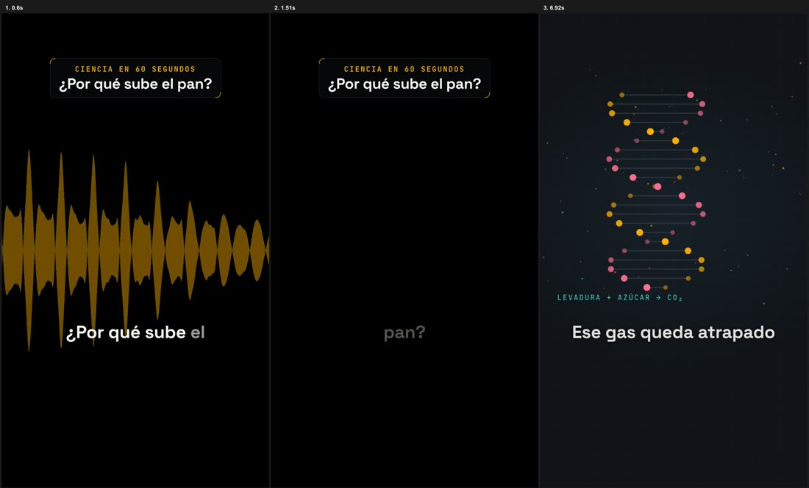

# VideoVibe

**Edición de video vertical guiada por agentes de IA.** · [English](README.md)

> **Estado: alfa.** En uso real con un canal; probado en macOS. Habrá asperezas.

Te grabas hablando a cámara. Le pides a tu agente (Claude Code, Codex, Gemini CLI…) que lo edite.
VideoVibe hace el resto con scripts deterministas y se detiene dos veces para que **tú** apruebes:

1. **Corte**: transcribe en local (whisper.cpp), quita retomas, muletillas y silencios, y te muestra un
   corte en papel para aprobar.
2. **Plan visual**: subtítulos palabra por palabra, animaciones que ilustran lo que dices, movimientos de
   cámara, corrección de color, música y efectos. Apruebas un borrador.
3. **Entrega**: un render por plataforma (TikTok, Reels, anuncio…), copy y portada, y una verificación
   técnica (resolución, códecs, volumen −14 LUFS) antes de darlo por terminado.



## Qué lo hace distinto

- **Pensado para agentes.** Una sola entrada para cualquier agente CLI ([`AGENTS.md`](AGENTS.md)), scripts
  con salida JSON y un orquestador (`bin/edit`) que avanza solo y se detiene donde decide una persona.
- **Multicanal.** Cada canal (persona o marca) tiene su perfil, estilo, paleta, ritmo, sonido y
  aprendizajes. El motor no conoce ningún canal; los tuyos pueden vivir en un repo privado.
- **Sonido incluido.** Limpieza de voz medida en cada grabación, música que baja sola bajo tu voz,
  efectos sintetizados por canal (o grabados por ti) y sincronía con micrófono externo.
- **Licencias en serio.** Cada pista y efecto registra su licencia; la versión «anuncio» cambia a música
  apta para publicidad pagada.
- **Local primero.** Transcripción, corte, sonido y render corren en tu máquina.

## Inicio rápido

```bash
git clone https://github.com/Delkoman88/videovibe && cd videovibe
bin/setup          # instala dependencias (macOS/Homebrew o Linux/apt) y modelos; ver INSTALL.es.md
bin/demo           # edita un video de prueba de punta a punta en el canal de ejemplo (~10 min; --quick ≈ 1 min)
```

**¿Primera vez?** Abre tu agente (Claude Code, Codex, Gemini CLI…) en la carpeta `videovibe` y dile:

> «Hola, es mi primera vez con VideoVibe.»

Te explicará cómo funciona, te ofrecerá una demo de un minuto, te hará 6 preguntas básicas y dejará listo
tu canal; después te pedirá tu primer video. También puedes hacerlo a mano:

```bash
bin/new-channel mi-canal --name "Mi Canal" --lang es
```

> «Lee AGENTS.md. Completa mi canal `mi-canal` preguntándome lo que necesites.»
>
> «Edita una pieza nueva de `mi-canal` con el material de `~/Descargas/toma1.mp4`.»

**Dos carpetas para recordar** dentro de `videovibe`: deja tus videos originales en **`input/`** (y solo dile a
tu agente el nombre del archivo), y encuentra tus videos terminados en **`deliveries/<Canal>/<fecha> <pieza>/`**:
el video de cada plataforma, su portada y su texto, listos para subir.
>
> (Por dentro: `bin/new-piece mi-canal toma1 --from ~/Descargas/toma1.mp4` y luego `bin/edit`.)

**Tus canales en un repo privado:** crea `local.json` en la raíz con `{"channels_dir": "~/mis-canales"}`
(o usa la variable `VIDEOVIBE_CHANNELS`). Así el motor se actualiza con `git pull` sin mezclarse con lo tuyo.

## Idioma

El contenido puede ser en **español o inglés** (subtítulos, reglas del corte, muletillas: `lang/es.json`,
`lang/en.json`; un idioma nuevo es un archivo JSON). La documentación para agentes está en **español**.

## Requisitos

macOS o Linux · ffmpeg (con `zscale` para el HDR de los teléfonos) · whisper.cpp · Node ≥ 22 · Python 3
+ numpy · Chrome/Chromium (render HTML → video con [HyperFrames](https://hyperframes.heygen.com)).
`bin/setup` los instala; `bin/doctor` los revisa.

## Estructura

| Ruta | Qué es |
|---|---|
| `AGENTS.md` | Entrada para agentes (reglas, qué leer según la tarea) |
| `bin/` | `welcome` (primeros pasos), `setup`, `demo`, `new-channel`, `new-piece`, `edit` (orquestador), `status`, `doctor` |
| `scripts/` | Pipeline: ingesta, transcripción, corte, voz, subtítulos, composición, verificación, sonido |
| `formats/` | Formatos de animación (genéricos + paquetes temáticos) |
| `channels/` | `_template` y `science-60` (ejemplo ficticio) |
| `docs/` | Pipeline, storyboard, sonido, canales, decisiones, estado y pendientes |

## Contribuir

Issues y pull requests bienvenidos: [CONTRIBUTING.md](CONTRIBUTING.md).

## Licencia

[Apache-2.0](LICENSE). Componentes de terceros y sus licencias: [NOTICE](NOTICE).
Arquitectura inspirada en el kit «WeAreNoCode YouTube Editor» (reglas + scripts deterministas +
storyboard JSON + revisiones humanas); no reutiliza su contenido.
