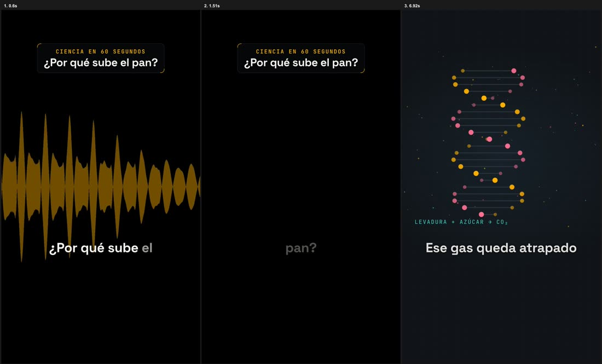

# VideoVibe

**Vertical video editing driven by AI coding agents.** · [Español](README.es.md)

> **v0.13.3-alpha.** Real multi-channel deliveries, including Ubuntu/WSL, and a fully passing test suite. Validated locally on macOS and in remote CI (Ubuntu); WSL validation of the current integrity layer is pending. Delegated execution on native Windows is currently blocked. See [status and limitations](docs/status/STATUS.md) (Spanish).

Bring your camera footage, B-roll or screen recordings. Ask your agent (Claude Code, Codex, Gemini CLI…) to
edit a piece for your channel. VideoVibe does the rest with deterministic scripts, and stops twice for **your** approval:

1. **Cut** — transcribes locally (whisper.cpp), removes retakes, fillers and silences, and shows you a
   paper cut to approve.
2. **Visual plan** — subtitles word by word, animations that illustrate what you say, camera moves,
   color correction, music and sound effects. The agent checks the opening, visual choices and ending
   before the preview. You approve a draft through a guided review with 3–5 concrete questions.
3. **Delivery** — one render per platform (TikTok, Reels, ads…), copy and cover, and a technical check
   (resolution, codecs, −14 LUFS loudness) before anything is "done".



## Why it's different

- **Agent-native.** One entry point for any CLI agent ([`AGENTS.md`](AGENTS.md)), scripts with JSON
  output, and an orchestrator (`bin/edit`) that advances by itself and pauses only where a human must decide.
- **Multi-channel.** Each channel (person or brand) has its own profile, style, palette, rhythm, sound
  and learnings. The engine knows no channel; your channels can live in a private repo.
- **Animations and effects à la carte.** 36 animation formats in optional packs (kinetic type, Lottie,
  3D molecules, cinematic 3D with Three.js, hand-drawn whiteboard, data charts with d3, CC0 science icons),
  effects on the footage (text behind you, background swap, glow, freeze), beat-synced hits and overlay
  transitions — all in your brand colors, deterministic, and loaded only when a scene uses them.
- **Animation direction per piece.** Compare restrained, balanced and energetic profiles; reuse narrative objects and anchor animation to spoken words. Automated visual checks support the human review. Existing pieces keep their animation settings. See the [animation direction guide](docs/animation-direction.md) (Spanish).
- **Storytelling grounded in your footage.** Skills help the agent propose a story from actual sources,
  check context and continuity, and prepare platform copy. Creative judgment remains subject to your
  cut and visual-plan approvals; the system does not promise retention gains. See [storytelling](docs/storytelling.md)
  and [editorial guidance](docs/editorial.md) (Spanish).
- **B-roll with its own sound.** Reframe supporting footage and screen recordings; optionally retain
  synchronized source audio with gain, fades and ducking under speech. No separate SFX registration
  or four-second SFX limit. Existing inserts stay silent unless explicitly enabled.
- **Sound included.** Voice cleanup measured per recording, music with ducking under your voice,
  synthesized sound effects per channel (or your own recordings), and external-mic sync.
- **Licensing taken seriously.** Every track and effect records its license; an "ad" version swaps to
  music cleared for paid ads.
- **Local first.** Transcription, cutting, sound and rendering run on your machine.

## Current limits

The engine is still alpha. Gemini CLI and Muse Code end-to-end validation is pending. Screen-recording
speech is not yet a source for the spoken cut, sentence reordering is unsupported, and subject cutouts
can include nearby objects or lose details. Visual checks help identify technical problems; agents
must inspect cutouts and use conservative alternatives when needed. Covers currently use a video frame.
Real user feedback is still needed to assess editorial quality across different channels.

## Quick start

```bash
git clone https://github.com/Delkoman88/videovibe && cd videovibe
bin/setup          # installs dependencies (macOS/Homebrew or Linux/apt) and models — see INSTALL.md
bin/demo           # edits a test video end to end on the example channel (~10 min; --quick ≈ 1 min)
```

**First time?** Open your agent (Claude Code, Codex, Gemini CLI…) in the `videovibe` folder and say:

> "Hi, it's my first time with VideoVibe."

It will explain how it works, offer a one-minute demo, ask you 6 basic questions and set up your
channel — then ask for your first video. You can also do it by hand:

```bash
bin/new-channel my-channel --name "My Channel" --lang en
```

> "Read AGENTS.md. Complete my channel `my-channel` by asking me what you need."
>
> "Edit a new piece for `my-channel` with the footage in `~/Downloads/take1.mp4`."

**Two folders to remember** in the `videovibe` folder: put your original footage in **`input/`** (then just
tell your agent the file name), and find your finished videos in **`deliveries/<Channel>/<date> <piece>/`** — each
platform's video, cover and caption text, ready to upload.
>
> (Under the hood: `bin/new-piece my-channel take1 --from ~/Downloads/take1.mp4`, then `bin/edit`.)

**Your channels in a private repo:** create `local.json` in the repo root with
`{"channels_dir": "~/my-channels"}` (or set `VIDEOVIBE_CHANNELS`). The engine then updates with
`git pull` without mixing with your stuff.

## Language

Content can be in **English or Spanish** (subtitles, cut rules, fillers: `lang/en.json`, `lang/es.json`;
a new language is one JSON file). The agent-facing documentation is in **Spanish**; agents read it fine
and talk to you in your language. This README and [INSTALL.md](INSTALL.md) are bilingual.

## Requirements

macOS or Linux · ffmpeg (with `zscale` for phone HDR) · whisper.cpp · Node ≥ 22 · Python 3 + numpy ·
Chrome/Chromium (HTML → video rendering via [HyperFrames](https://hyperframes.heygen.com)). `bin/setup`
installs them; `bin/doctor` checks them.

## Project layout

| Path | What |
|---|---|
| `AGENTS.md` | Entry point for agents (rules, what to read for each task) |
| `bin/` | `welcome` (onboarding), `setup`, `demo`, `new-channel`, `new-piece`, `edit` (orchestrator), `status`, `doctor`, `animation-style` (profile previews and proposal snapshots) |
| `scripts/` | Pipeline: ingest, transcribe, paper cut, apply cut, voice, captions, compose, verify, sound tools |
| `.agents/skills/` | Editing and storytelling instructions, backed by canonical guides |
| `formats/` | Animation formats (generic + themed packs) |
| `channels/` | `_template` (template) and `science-60` (fictional example) |
| `docs/` | Pipeline, storyboard, sound, channels, decisions (ADRs), state and backlog |

## Contributing

Issues and pull requests are welcome — see [CONTRIBUTING.md](CONTRIBUTING.md).

## License

[Apache-2.0](LICENSE). Third-party components and their licenses: [NOTICE](NOTICE).
Architecture inspired by the "WeAreNoCode YouTube Editor" kit (rules + deterministic scripts +
JSON storyboard + human reviews); no content reused.

## Integrity of approvals and deliveries

New approvals bind the reviewed content, not just a timestamp. Resuming an older piece without enough
evidence requires another review; reading status does not migrate it. New deliveries use independent,
versioned copies under `deliveries/<Channel>/<piece>/versions/<fingerprint>/`; the agent opens the
specific version. Existing hard links can be detached explicitly using the [migration guide](docs/migration.md).
