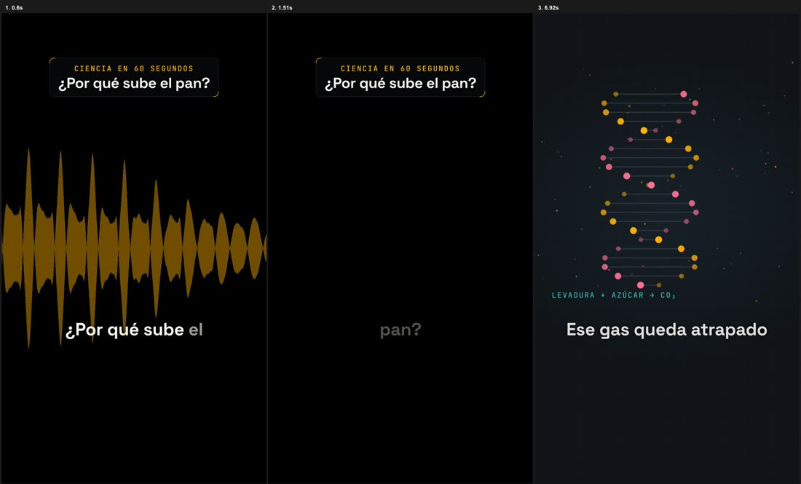

# VideoVibe

**Vertical video editing driven by AI coding agents.** · [Español](README.es.md)

> **Status: alpha.** Used in production for one real channel; tested on macOS. Expect rough edges.

You record yourself talking to the camera. You ask your agent (Claude Code, Codex, Gemini CLI…) to
edit it. VideoVibe does the rest with deterministic scripts, and stops twice for **your** approval:

1. **Cut** — transcribes locally (whisper.cpp), removes retakes, fillers and silences, and shows you a
   paper cut to approve.
2. **Visual plan** — subtitles word by word, animations that illustrate what you say, camera moves,
   color correction, music and sound effects. You approve a draft.
3. **Delivery** — one render per platform (TikTok, Reels, ads…), copy and cover, and a technical check
   (resolution, codecs, −14 LUFS loudness) before anything is "done".



## Why it's different

- **Agent-native.** One entry point for any CLI agent ([`AGENTS.md`](AGENTS.md)), scripts with JSON
  output, and an orchestrator (`bin/edit`) that advances by itself and pauses only where a human must decide.
- **Multi-channel.** Each channel (person or brand) has its own profile, style, palette, rhythm, sound
  and learnings. The engine knows no channel; your channels can live in a private repo.
- **Sound included.** Voice cleanup measured per recording, music with ducking under your voice,
  synthesized sound effects per channel (or your own recordings), and external-mic sync.
- **Licensing taken seriously.** Every track and effect records its license; an "ad" version swaps to
  music cleared for paid ads.
- **Local first.** Transcription, cutting, sound and rendering run on your machine.

## Quick start

```bash
git clone https://github.com/Delkoman88/videovibe && cd videovibe
bin/setup          # installs dependencies (macOS/Homebrew or Linux/apt) and models — see INSTALL.md
bin/demo           # edits a test video end to end on the example channel (~10 min; --quick ≈ 1 min)
```

**First time?** Open your agent (Claude Code, Codex, Gemini CLI…) in the `videovibe` folder and say:

> "Hi, it's my first time with VideoVibe."

It will explain how it works, offer a one-minute demo, ask you 6 basic questions and set up your
channel — then ask for your first video. You can also do it by hand:

```bash
bin/new-channel my-channel --name "My Channel" --lang en
```

> "Read AGENTS.md. Complete my channel `my-channel` by asking me what you need."
>
> "Edit a new piece for `my-channel` with the footage in `~/Downloads/take1.mp4`."

**Two folders to remember** in the `videovibe` folder: put your original footage in **`input/`** (then just
tell your agent the file name), and find your finished videos in **`deliveries/<Channel>/<date> <piece>/`** — each
platform's video, cover and caption text, ready to upload.
>
> (Under the hood: `bin/new-piece my-channel take1 --from ~/Downloads/take1.mp4`, then `bin/edit`.)

**Your channels in a private repo:** create `local.json` in the repo root with
`{"channels_dir": "~/my-channels"}` (or set `VIDEOVIBE_CHANNELS`). The engine then updates with
`git pull` without mixing with your stuff.

## Language

Content can be in **English or Spanish** (subtitles, cut rules, fillers: `lang/en.json`, `lang/es.json`;
a new language is one JSON file). The agent-facing documentation is in **Spanish**; agents read it fine
and talk to you in your language. This README and [INSTALL.md](INSTALL.md) are bilingual.

## Requirements

macOS or Linux · ffmpeg (with `zscale` for phone HDR) · whisper.cpp · Node ≥ 22 · Python 3 + numpy ·
Chrome/Chromium (HTML → video rendering via [HyperFrames](https://hyperframes.heygen.com)). `bin/setup`
installs them; `bin/doctor` checks them.

## Project layout

| Path | What |
|---|---|
| `AGENTS.md` | Entry point for agents (rules, what to read for each task) |
| `bin/` | `welcome` (onboarding), `setup`, `demo`, `new-channel`, `new-piece`, `edit` (orchestrator), `status`, `doctor` |
| `scripts/` | Pipeline: ingest, transcribe, paper cut, apply cut, voice, captions, compose, verify, sound tools |
| `formats/` | Animation formats (generic + themed packs) |
| `channels/` | `_template` (template) and `science-60` (fictional example) |
| `docs/` | Pipeline, storyboard, sound, channels, decisions (ADRs), state and backlog |

## Contributing

Issues and pull requests are welcome — see [CONTRIBUTING.md](CONTRIBUTING.md).

## License

[Apache-2.0](LICENSE). Third-party components and their licenses: [NOTICE](NOTICE).
Architecture inspired by the "WeAreNoCode YouTube Editor" kit (rules + deterministic scripts +
JSON storyboard + human reviews); no content reused.
